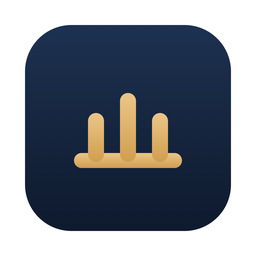
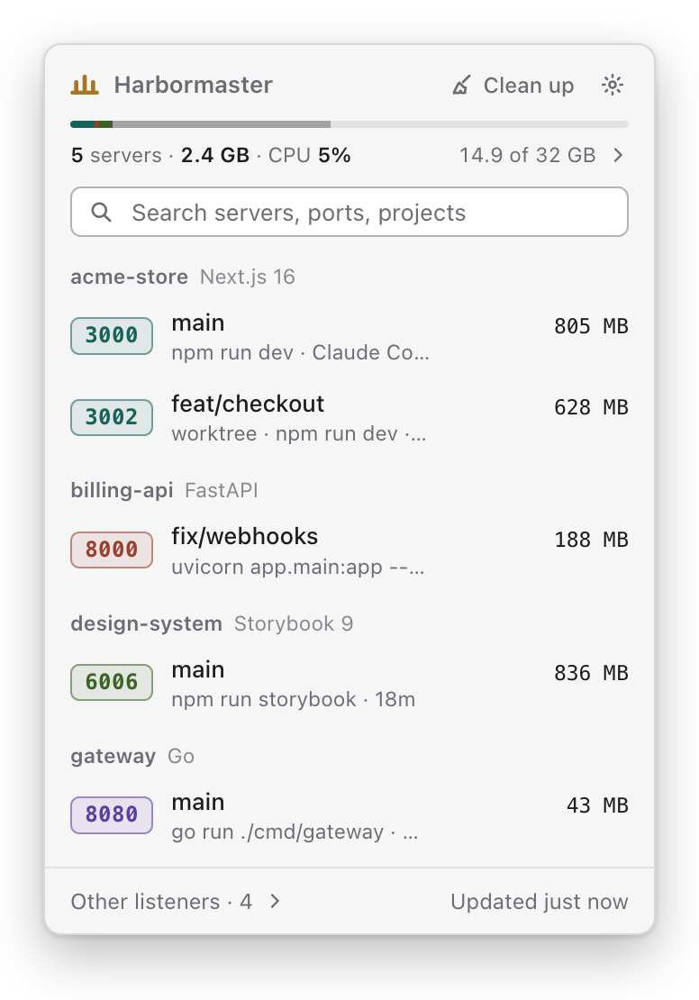
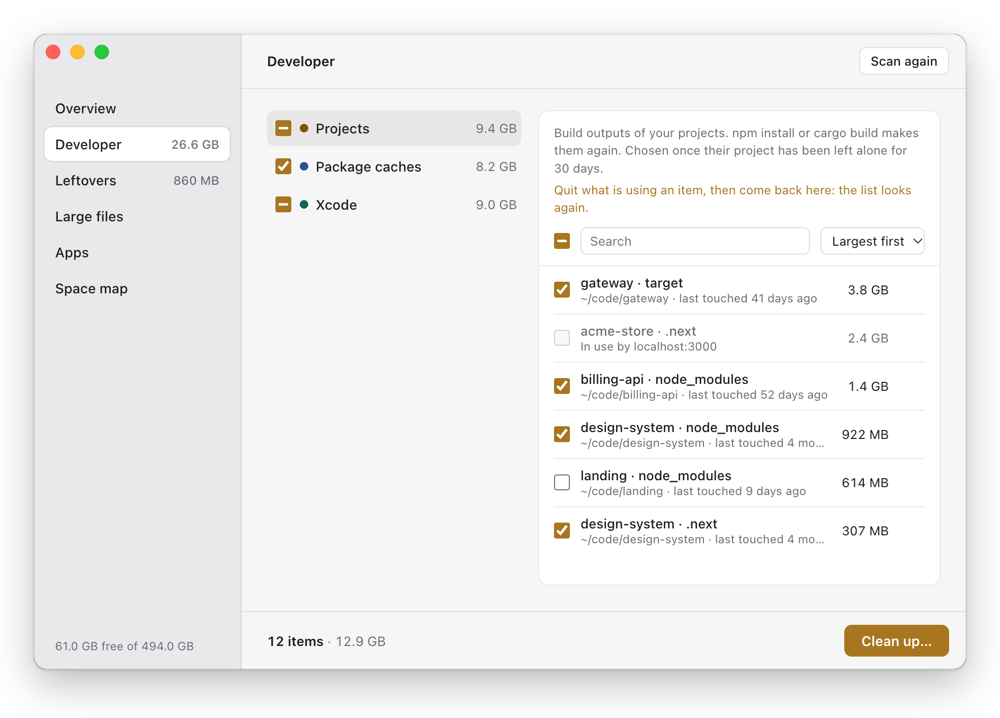
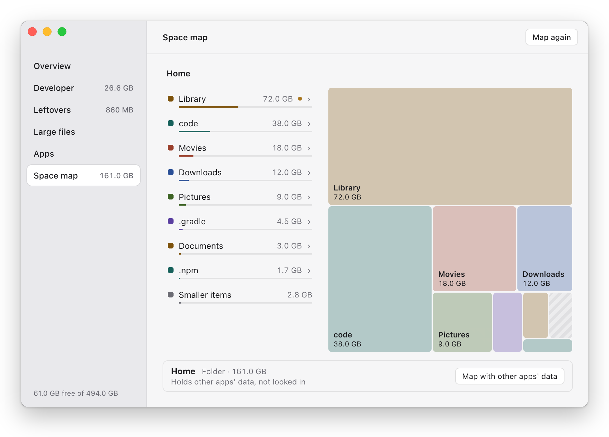

<p align="center">
  
</p>

<h1 align="center">Harbormaster</h1>

<p align="center">
  A menu bar app for macOS that shows the dev servers running on your machine and lets you stop them,<br>
  and finds the build outputs and caches your tools leave behind.
</p>

<p align="center">
  <picture>
    <source media="(prefers-color-scheme: dark)" srcset="docs/screenshots/panel-dark.png">
    
  </picture>
</p>

## Servers

The panel lists the dev servers listening on TCP ports, grouped by project when it can find one, with the
framework, the git branch or worktree, what started it (your terminal, a script such as `npm run dev`, a
coding agent), how long it has been running, its memory and a CPU trend. Other listeners that aren't
part of macOS are one click away, along with any program you told it in Settings never to count as a dev
server. From a row you can open a server in the browser, show its project in Finder, or stop it.

How a stop works:

- It first shows which processes will stop and which stay open, then asks the server to exit. If it is
  still running five seconds later, you're offered a forced stop.
- Right before each signal it checks again that every process is the one you approved: the same PID and
  start time, and no other program started since. The check and the signal are separate steps, so this
  narrows the window for a reused PID or a newly started program rather than closing it.
- It refuses system processes, other users' processes, the databases it recognizes, processes it couldn't
  fully read, anything Harbormaster itself runs under, and a server whose socket your shell, terminal or
  coding agent holds too. When a program outside the server holds the socket, it says so instead, since
  stopping the server wouldn't free the port.

Clicking the memory figure shows which apps use the memory, the dev servers first.

## Clean up

<picture>
  <source media="(prefers-color-scheme: dark)" srcset="docs/screenshots/cleaner-dark.png">
  
</picture>

A scan looks for:

- **Build outputs** in your projects: `node_modules`, `.next`, `.nuxt`, `.svelte-kit`, `.turbo` and
  `.parcel-cache` next to a `package.json`, and any folder tagged with a `CACHEDIR.TAG`, such as Cargo's
  `target`. Projects are looked for up to six folders deep in `~/Developer`, `~/Projects`, `~/code`,
  `~/src`, `~/dev`, `~/workspace`, `~/repos` and `~/work`, or in the folders you name in Settings.
- **Package caches** of npm, pnpm, Yarn, Bun, pip, uv, Poetry, Cargo, Go, Composer, Dart, Deno, SwiftPM,
  Carthage, Gradle, Maven, NuGet, CocoaPods, Homebrew and Playwright.
- **Xcode data**: DerivedData, simulator caches, device support files and archives.
- **Leftovers**: app caches, logs and the Trash.

Two more sections look only when you ask. **Large files** lists files taking 50 MB or more on disk in your
home folder outside the Library, leaving out hidden files, the insides of app bundles and other packages,
`node_modules`, folders tagged as caches, and files with more than one hard link. **Apps** lists the apps
in `/Applications` and `~/Applications`, and one folder down in each, that belong to you and aren't locked,
with the room each takes; one it can't measure in full is left out.

What gets chosen, and what happens to it:

- Caches and logs are chosen for you. Build outputs are listed whatever their age, and chosen when
  neither the project folder, anything directly in it, nor anything directly in its `.git` folder has
  changed for 30 days, or for as many days as you set in Settings. Device support
  files are chosen except the most recently changed one for iOS and for watchOS. Once you confirm, what
  is chosen is deleted for good.
- Things that may be yours to keep are listed but never chosen for you, and go to the Trash instead of
  being deleted: Maven's local repository, NuGet's packages, Xcode archives, the JetBrains caches that hold
  Local History, large files and apps. Emptying the Trash deletes what is in it for good, and is never
  chosen for you either.
- An item that one of your processes is found using is locked, with that process named. Use is checked
  again right before anything is removed. When nothing but Gradle or Kotlin daemons uses it and no dev
  server runs in its project, it gets a Stop button, unless the daemons are processes a server's stop
  would refuse. You see each daemon with its PID and command first, then they are asked to exit as
  `kill` asks, and never forced.
- It doesn't follow symbolic links, except that a project folder from the list above which is itself a
  link is looked in when it leads somewhere inside your home folder. Before removing an item it checks
  that it is still the folder the scan found, and skips it if it was moved or replaced.

## Space map

<picture>
  <source media="(prefers-color-scheme: dark)" srcset="docs/screenshots/map-dark.png">
  
</picture>

Shows where the space in your home folder goes, the Library and hidden folders included. Click a folder to
go inside it. Nothing is moved or deleted from here. Other apps' data in `Library/Containers` and
`Library/Group Containers` is left out unless you ask for it, since macOS asks for your permission first,
and a folder that couldn't be read in full says so.

## Command line

```console
$ harbormaster               # dev servers, grouped by project
$ harbormaster --all         # every listener, not only dev servers
$ harbormaster why 5173      # who holds a port, or why it can't be used
$ harbormaster stop 3000     # shows what will stop, then asks
$ harbormaster clean         # what could go, and what would be chosen
$ harbormaster clean --yes   # removes what would be chosen, without asking
```

`ls` and `clean` take `--json`. `stop` also takes `--yes`, `--force`, `--wait <seconds>`, `--pid <pid>`
to stop the server a process belongs to, and `--address <ip>` to pick one server when several share a port.

## Building

There is no signed release yet. You need macOS 12 or later, the Xcode Command Line Tools
(`xcode-select --install`), [rustup](https://rustup.rs), which installs the Rust version pinned in
`rust-toolchain.toml` on the first build, and Node.js 22.22.2 or a later 22.x, 24.15.0 or a later 24.x, or
26 and up.

```sh
git clone https://github.com/alpgurlee/harbormaster.git
cd harbormaster/app
npm ci
npm run tauri build -- --bundles app
```

The app ends up in `target/release/bundle/macos/Harbormaster.app`. To install the command line tool,
run this from the repository's root:

```sh
cargo install --path crates/cli
```

Ports and processes are read straight from the kernel through `libproc` and `sysctl`; nothing shells out
to `lsof` or `ps`. The scanning is Rust, and the windows are [Tauri](https://tauri.app) with React.

## Status

macOS only for now, built and tested on macOS 27 with Apple silicon. Windows support is planned.

## License

[MIT](LICENSE)
